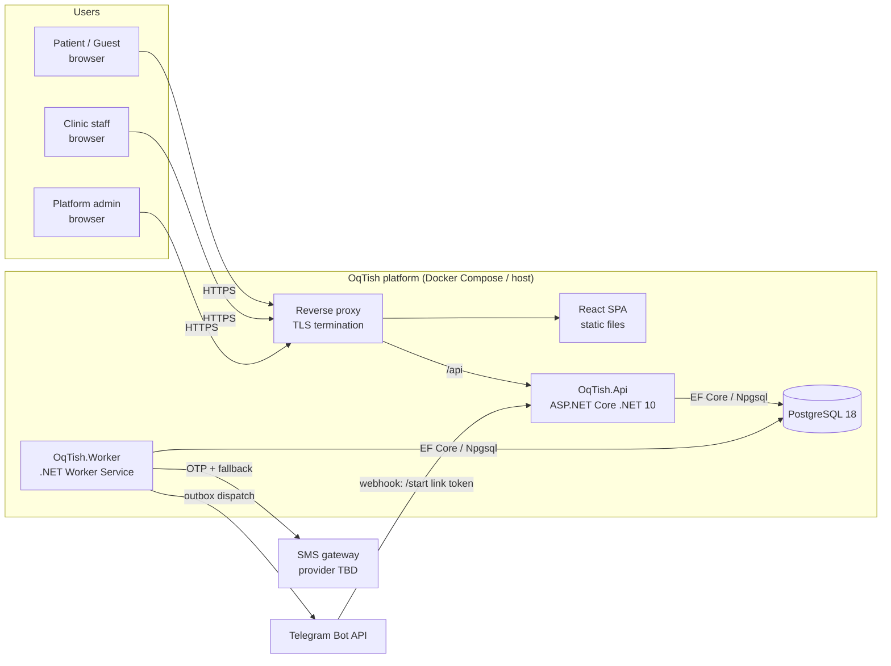

# Architecture

Status: **Phase 1 proposal**. Nothing described here is implemented yet.

## 1. Style

A **modular monolith**: one deployable API, one Worker process, one PostgreSQL database, one React SPA.
Microservices are rejected for v1 (see `DECISIONS.md` ADR-001). Booking, the outbox and the ledger must
commit in the **same database transaction**, and a single database makes that trivial and verifiable.

## 2. System context



The API **never** calls Telegram or SMS directly inside a business transaction. It writes an outbox
row. The Worker delivers it. A delivery failure therefore cannot roll back a committed appointment.
OTP SMS also goes through the outbox, with a short polling interval and a 5-minute code TTL.

## 3. Solution layout (planned)

```
OqTish.sln
src/
  OqTish.Domain/            entities, value objects, state machines, domain errors. No dependencies.
  OqTish.Application/       use cases per module, ports, authorization rules, validators, DTOs.
  OqTish.Infrastructure/    EF Core DbContext/configurations/migrations, Identity stores,
                            Telegram/SMS adapters, TimeProvider, outbox writer.
  OqTish.Api/               HTTP endpoints, authn, rate limiting, ProblemDetails, OpenAPI, health checks.
  OqTish.Worker/            outbox dispatcher, expiry sweeper, reminders, daily summaries, retention.
web/                        React + TypeScript (Vite). API client generated from OpenAPI.
tests/
  OqTish.Domain.Tests/      xUnit unit tests: state machine, money, commission math.
  OqTish.Application.Tests/ xUnit unit tests: authorization rules, validators.
  OqTish.IntegrationTests/  xUnit + Testcontainers (real PostgreSQL) + WebApplicationFactory.
  OqTish.ArchitectureTests/ reflection tests: layer deps, no entities in API contracts, no double money.
web/src/**/*.test.tsx       Vitest + Testing Library + MSW.
deploy/                     compose files, reverse proxy config, backup scripts.
```

Modules are namespaces/folders inside each layer, not separate assemblies:

| Module | Owns |
|---|---|
| Identity | users, auth identities (phone, Telegram, email+password), sessions, OTP, account linking |
| Tenancy | clinics, branches, verification status, time zones |
| Staff | memberships, roles, branch access grants, permission resolution |
| Catalog | services, branch service prices |
| Scheduling | doctors, doctor–branch/service links, working hours, time off, time blocks |
| Booking | appointments, status history, reservations, expiry |
| Finance | completions, payments, allocations, commission rules, ledger, settlements, summaries |
| Notifications | outbox, Telegram link tokens, delivery attempts, templates |
| Reviews | reviews, moderation |
| Audit | audit log, platform break-glass access log |

A module talks to another only through its Application interface. The one exception is explicit
read-model queries in Reporting.

## 4. Request pipeline (API)

1. TLS at the reverse proxy. Forwarded headers are trusted only from the proxy network.
2. Rate limiter (per IP when anonymous, per user when authenticated, strict buckets for OTP and login).
3. Authentication: a cookie session backed by a server-side session table. This establishes **who**.
4. DTO binding + validator → 400 ProblemDetails.
5. Handler **loads the resource with its ownership path** (clinic, branch) from the DB, calls
   `IAccessPolicy.Authorize(user, permission, scope)`, and runs the transaction.
6. Error mapping: NotFound→404, Forbidden→403, Conflict→409, RuleViolation→422, else 500 with a correlation id only.
7. Structured JSON log with redaction.

Client-supplied clinicId/branchId/patientId/doctorId are **lookup keys only**, never trusted scope.

## 5. Booking: create request

```mermaid
sequenceDiagram
    autonumber
    participant SPA
    participant API as Api + Application
    participant DB as PostgreSQL
    SPA->>API: POST /api/appointments (Idempotency-Key)
    API->>DB: load branch+clinic (approved, active), branch service price + duration
    API->>DB: BEGIN (READ COMMITTED)
    API->>DB: idempotency lookup (user,key) → replay if present
    API->>DB: SELECT … FROM branch_booking_locks WHERE branch_id=$b FOR UPDATE
    API->>DB: expire overdue Pending in this branch (status, deactivate blocks, outbox)
    API->>DB: candidates = provide service ∧ at branch ∧ active ∧ working hours cover [start,end)
    loop each candidate (least flexible / least booked first)
        API->>DB: SAVEPOINT; INSERT doctor_time_block(doctor,[start,end),active)
        alt 23P01 exclusion violation
            API->>DB: ROLLBACK TO SAVEPOINT
        else inserted
            API->>API: break
        end
    end
    alt none fits
        API->>DB: ROLLBACK
        API-->>SPA: 409 Conflict
    else
        API->>DB: INSERT appointment(Pending, expires_at=now()+30m), history, outbox, audit, idempotency
        API->>DB: COMMIT
        API-->>SPA: 201 (no doctor exposed)
    end
```

- The **branch lock** serialises per-branch booking decisions.
- The **exclusion constraint** `EXCLUDE USING gist (doctor_id WITH =, period WITH &&) WHERE (is_active)`
  is the correctness guarantee. It also covers paths that don't take the lock, such as time off.
- This "provisional doctor hold" needs approval: `DECISIONS.md` OD-01.

## 6. Confirm vs. expire

```mermaid
sequenceDiagram
    autonumber
    participant Staff as Staff (API)
    participant Sweeper as Worker sweeper
    participant DB as PostgreSQL
    par Staff confirms
        Staff->>DB: BEGIN; lock branch row; SELECT appointment FOR UPDATE
        Staff->>DB: status='Pending' AND expires_at > now() ?
        Staff->>DB: authz on appointment.branch_id; doctor eligible?
        Staff->>DB: UPDATE block SET doctor_id=$chosen (exclusion re-checked)
        Staff->>DB: UPDATE appointment SET status='Confirmed' WHERE id AND status='Pending' AND expires_at>now()
        Staff->>DB: history + outbox + audit; COMMIT
    and Sweeper expires
        Sweeper->>DB: SELECT id … WHERE status='Pending' AND expires_at<=now() FOR UPDATE SKIP LOCKED LIMIT 100
        Sweeper->>DB: UPDATE … SET status='Expired' WHERE id=ANY($ids) AND status='Pending'
        Sweeper->>DB: deactivate blocks; history; outbox; COMMIT
    end
```

Exactly one transition wins. Both paths lock the row and use a conditional UPDATE on
`status='Pending'`. Confirm also checks the deadline using **DB time**, so a late confirm fails even
when the sweeper is down. Reads present an overdue Pending as Expired. These are **design claims** that
Phase 4 tests must prove.

## 7. Worker jobs

| Job | Trigger | Safety |
|---|---|---|
| Outbox dispatcher | every 2 s | `FOR UPDATE SKIP LOCKED`, bounded exponential backoff + jitter, dedup key |
| Expiry sweeper | every 30 s | conditional update, `SKIP LOCKED` |
| Reminders | outbox `not_before` | keyed (appointment, kind). Cancelled if no longer Confirmed |
| Daily summaries | after branch-local midnight + on demand | rebuilt from the ledger. A cache only |
| Retention | nightly | expired OTPs/sessions, old delivered outbox rows |

## 8. Frontend

React + TS + Vite, React Router, TanStack Query, client generated from OpenAPI, i18n. Each screen
handles the loading, empty, 400/422, 403, 404, 409 and 5xx (with correlation id) states. The UI shows
prices, slots and countdowns, and the server recomputes all of them on every write.

## 9. Configuration

Non-secret defaults live in appsettings. Secrets come from env vars or Docker secrets only.
`.env.example` contains placeholders. The SPA reads its API base URL from a runtime `config.json`.
