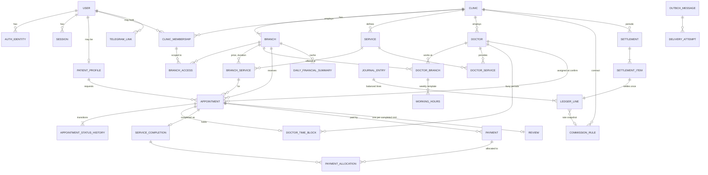

# Database Design

Status: Phase 1 proposal, partly implemented. Migrations: `InitialExtensions`, `CoreIdentityTenancy` (§2.1), `CatalogScheduling` (§2.2), `Booking` (§2.3), `Finance` (§2.4), `Notifications` (§2.5), `ReviewHardening`, `StoredImages` (§2.6).

PostgreSQL 18 with the `btree_gist` and `citext` extensions. All timestamps are `timestamptz` (UTC).
Money is `numeric(19,2)` with a `currency char(3)` (v1: UZS). Keys are UUID v7. Schemas: `identity`,
`tenancy`, `staff`, `catalog`, `scheduling`, `booking`, `reviews`, `reports`, `finance`, `notify`, `audit`, `common`.

## 1. ER diagram



## 2. Tables and constraints (key columns)

**identity**
- `users` (id, display_name, status, security_stamp)
- `auth_identities` (user_id, kind Phone/Telegram/EmailPassword, normalized_identifier, verified_at). **UNIQUE(kind, normalized_identifier)**
- `password_credentials` (user_id, hash)
- `otp_challenges` (purpose, identifier_hash, **code_hash**, expires_at, attempts, consumed_at)
- `sessions` (user_id, expires_at, revoked_at, ip_hash, user_agent)
- `account_link_requests` (user_id, target_kind, target_identifier_hash, proof_token_hash, expires_at)
- `patient_profiles` (user_id PK, full_name, contact_phone). **No medical fields.**

**tenancy / staff**
- `clinics` (verification_status Pending/Approved/Suspended/Rejected)
- `branches` (clinic_id, address, lat/lon numeric, time_zone IANA default `Asia/Tashkent`, is_active). **UNIQUE(clinic_id, id)** is the target for composite FKs
- `branch_booking_locks` (branch_id PK), the row locked during booking/confirm
- `clinic_memberships` (clinic_id, user_id, role, scope Clinic/Branches, status). UNIQUE(clinic_id, user_id)
- `branch_access` (clinic_id, membership_id, branch_id), composite FKs to both sides
- `platform_admin_grants` (user_id, permission, granted_by, revoked_at)

**catalog / scheduling**
- `services` (clinic_id, name, is_active). UNIQUE(clinic_id, id)
- `branch_services` (clinic_id, branch_id, service_id, price ≥ 0, price_kind Fixed/From, duration_minutes 5–480). FK (clinic_id, branch_id), FK (clinic_id, service_id)
- `doctors` (clinic_id, user_id null, display_name, is_active). UNIQUE(clinic_id, id)
- `doctor_branches` (clinic_id, doctor_id, branch_id) and `doctor_services` (clinic_id, doctor_id, service_id), composite FKs
- `working_hours` (clinic_id, doctor_id, branch_id, weekday, start_local, end_local, effective_from/to). FK → doctor_branches. CHECK start < end
- `doctor_time_blocks` (clinic_id, branch_id, doctor_id, period tstzrange `[)`, kind Hold/Appointment/TimeOff, appointment_id UNIQUE null, is_active)
  ```sql
  CREATE EXTENSION IF NOT EXISTS btree_gist;
  ALTER TABLE scheduling.doctor_time_blocks
    ADD CONSTRAINT ex_doctor_time_blocks_no_overlap
    EXCLUDE USING gist (doctor_id WITH =, period WITH &&) WHERE (is_active),
    ADD CONSTRAINT ck_period_valid CHECK (NOT isempty(period) AND lower_inc(period) AND NOT upper_inc(period));
  ```
  The predicate can't use `now()`, which is why the booking transaction expires overdue holds first (ADR-006).

Working hours are branch-local wall-clock times, converted per date with the IANA zone (DST-safe).

**booking**
- `appointments` (clinic_id, branch_id, service_id, patient_user_id, doctor_id null, starts_at, ends_at, status, expires_at, quoted_price, price_kind, currency, contact_name, contact_phone, xmin concurrency token)
  - FK (clinic_id, branch_id)→branches. FK (clinic_id, branch_id, service_id)→branch_services. FK (clinic_id, branch_id, doctor_id)→doctor_branches. FK (clinic_id, doctor_id, service_id)→doctor_services
  - CHECK ends_at > starts_at. CHECK status in the 8 values. CHECK doctor_id NOT NULL when status ∈ {Confirmed, Completed, NoShow}. CHECK Pending ⇒ expires_at NOT NULL
  - Indexes: (branch_id, starts_at), (patient_user_id, created_at DESC), partial (expires_at) WHERE status='Pending'
- `appointment_status_history` (from, to, actor_kind, actor_user_id, reason_code, occurred_at)
- `idempotency_keys` PK(user_id, key), request_hash, response snapshot

**finance** (details in FINANCIAL_RULES.md)
- `service_completions` (appointment_id **UNIQUE**, charged_amount)
- `payments` (direction In/Refund, method, amount > 0, status Recorded/Failed/Voided, collected_by Clinic/Platform, refund_of_payment_id, **UNIQUE(clinic_id, idempotency_key)**)
- `payment_allocations` (payment_id, service_completion_id, amount)
- `commission_rules` (basis enum with **no default**, rate numeric(7,4) or fixed, rounding_mode, effective range, contract_reference, approved_by). Exclusion constraint: no overlapping ranges per (clinic, basis)
- `journal_entries` (entry_type, **source_event_key UNIQUE**, posting_date_local, reverses_entry_id)
- `ledger_lines` (account, party, signed amount, currency, commission_rule_id, rate_snapshot, basis_amount_snapshot)
- `settlements` (clinic, period, status). UNIQUE(clinic_id, period_start) WHERE status <> 'Voided'
- `settlement_items` (ledger_line_id **UNIQUE**)
- `daily_financial_summaries` PK(branch_id, local_date), totals, ledger_watermark. Rebuildable

Append-only: no UPDATE/DELETE grants on `journal_entries`, `ledger_lines`, `audit_log` or
`appointment_status_history`, plus a trigger guard. A deferred constraint trigger requires every
journal entry to balance to 0.

**notify / reviews / audit**
- `outbox_messages` (type, dedup_key UNIQUE, payload jsonb of ids + minimal display data, not_before, status, attempts, next_attempt_at, last_error scrubbed)
- `delivery_attempts`, `telegram_links` (user_id, chat_id), `telegram_link_tokens` (token_hash, expires_at, used_at)
- `reviews` (appointment_id UNIQUE, rating 1–5, text, moderation_status)
- `audit_log` (actor, action, clinic_id, branch_id, target, correlation_id, scrubbed details)

## 2.1 Implemented — migration `CoreIdentityTenancy` (BE1a, 2026-10-18)

All ids `uuid` (v7, app-generated), enums stored as `text` with a `CHECK (col IN (…))` constraint, times `timestamptz`.

| Table | Key columns / constraints |
|---|---|
| `identity.users` | id, display_name, status (Active/Suspended/Deleted), security_stamp, status_reason, created_at, updated_at, deleted_at. ix(status) |
| `identity.auth_identities` | user_id → users (cascade), kind (Phone/Telegram/EmailPassword), normalized_identifier (E.164 / Telegram id / lower-case e-mail), verified_at, last_used_at. **UNIQUE(kind, normalized_identifier)**, UNIQUE(user_id, kind) |
| `identity.password_credentials` | user_id PK → users, password_hash (Identity V3 format), failed_attempts ≥ 0, locked_until |
| `identity.otp_challenges` | purpose (SignIn/LinkPhone/PasswordReset), identifier_hash (HMAC), phone (null for decoys), user_id null → users, code_hash (HMAC), ip_hash, expires_at > created_at, attempts ≤ max_attempts, consumed_at. ix(identifier_hash, created_at), ix(ip_hash, created_at), ix(created_at) for retention |
| `identity.sessions` | user_id → users, **token_hash UNIQUE** (SHA-256 of the cookie token), security_stamp, auth_method, created_at, last_seen_at, expires_at, revoked_at, revoked_reason, ip_hash, user_agent(256). ix(user_id, revoked_at) |
| `identity.totp_credentials` | user_id PK, protected_secret (Data Protection), enabled_at (null = pending setup), last_used_step (replay guard) |
| `identity.patient_profiles` | user_id PK, full_name(100), contact_phone, is_anonymised. No medical fields |
| `identity.data_protection_keys` | ASP.NET Data Protection key ring (id, friendly_name, xml) |
| `tenancy.clinics` | name, legal_name, description, phone, verification_status (Pending/Approved/Suspended/Rejected), status_reason, created_by_user_id → users (set null) |
| `tenancy.branches` | clinic_id → clinics, name, district, address, latitude/longitude numeric(9,6) (range checks, both or neither), phone, time_zone default `Asia/Tashkent`, is_active. **UNIQUE(clinic_id, id)** (`ak_branches_clinic_id_id`) |
| `tenancy.branch_opening_hours` | (clinic_id, branch_id) → branches cascade, weekday 1–7, opens < closes, UNIQUE(branch_id, weekday, opens) |
| `tenancy.branch_booking_locks` | branch_id PK, (clinic_id, branch_id) → branches cascade. **Row created by trigger `trg_branches_booking_lock` on branch insert** — never insert manually |
| `staff.clinic_memberships` | clinic_id → clinics, user_id → users, role, scope (Clinic/Branches), status (Active/Suspended/Removed). **UNIQUE(clinic_id, user_id)**, UNIQUE(clinic_id, id) |
| `staff.branch_access` | PK(membership_id, branch_id); (clinic_id, membership_id) → memberships and (clinic_id, branch_id) → branches, both composite + cascade (cross-clinic grants are impossible, tested) |
| `staff.staff_invitations` | clinic_id → clinics (cascade), phone_hash (HMAC of E.164), phone_masked, role, scope, branch_ids uuid[] (non-empty when scope = Branches), invited_by_user_id, expires_at > created_at, accepted_at, accepted_by_user_id, revoked_at. Partial ix(phone_hash) WHERE open |
| `staff.platform_admin_grants` | user_id, permission, granted_by/revoked_by user ids, granted_at, revoked_at. UNIQUE(user_id, permission) WHERE revoked_at IS NULL |
| `notify.outbox_messages` | type, **dedup_key UNIQUE**, payload jsonb, created_at, not_before, status (Pending/Processing/Sent/Failed/Cancelled; BE4 adds Skipped), attempts ≥ 0, next_attempt_at, last_error(500), sent_at. Partial ix(next_attempt_at) WHERE status = 'Pending'. BE4 columns: §2.5 |
| `notify.telegram_link_tokens` | user_id → users, token_hash UNIQUE (SHA-256), expires_at, used_at |
| `notify.telegram_links` | user_id PK → users, telegram_user_id UNIQUE, chat_id, linked_at (BE4: is_active, language_code … §2.5) |
| `audit.audit_log` | occurred_at (default now()), actor_kind (User/System/Anonymous), actor_user_id, action, clinic_id, branch_id, target_type, target_id, correlation_id, ip_hash, details jsonb. No FKs. **Append-only:** trigger `trg_audit_log_append_only` (UPDATE/DELETE) and `trg_audit_log_no_truncate` raise 42501 for every role; `REVOKE UPDATE, DELETE, TRUNCATE … FROM oqtish_app` when that role exists |
| `common.idempotency_keys` | PK(user_id, key ≤ 64), request_hash (SHA-256 of the request JSON), status (InProgress/Completed), response_json jsonb, created_at, completed_at |

Not created (by decision): `identity.account_link_requests` (conflicts are audited instead, DECISIONS.md BE1a-5).

## 2.2 Implemented — migration `CatalogScheduling` (BE1b, 2026-10-18)

| Table / object | Key columns / constraints |
|---|---|
| `tenancy.clinics` (+2 columns) | `rating_average numeric(3,2)` null (CHECK 1..5), `review_count int` default 0 (CHECK ≥ 0). Maintained by review moderation (BE2) via `Clinic.SetRating`; read by public search |
| `catalog.services` | id, clinic_id → clinics, name(200), category(32, key of the fixed catalogue, validated in the handler), is_active, created_at, updated_at. **UNIQUE(clinic_id, id)**. ix(clinic_id, is_active), ix(category) |
| `catalog.branch_services` | PK(branch_id, service_id); **UNIQUE(clinic_id, branch_id, service_id)** (target of the appointment FK in BE2); FK (clinic_id, branch_id) → branches and (clinic_id, service_id) → services, both composite + cascade. price numeric(19,2) **CHECK ≥ 0**, currency char(3) CHECK 'UZS', price_kind CHECK Fixed/From, duration_minutes **CHECK 5..480**, is_active |
| `scheduling.doctors` | id, clinic_id → clinics, user_id null → identity.users (restrict), display_name(200), is_active. **UNIQUE(clinic_id, id)**; **UNIQUE(clinic_id, user_id) WHERE user_id IS NOT NULL** (a user is a doctor at most once per clinic); ix(user_id) |
| `scheduling.doctor_branches` | PK(doctor_id, branch_id); **UNIQUE(clinic_id, doctor_id, branch_id)**; composite FKs (clinic_id, doctor_id) → doctors and (clinic_id, branch_id) → branches (cascade) |
| `scheduling.doctor_services` | PK(doctor_id, service_id); **UNIQUE(clinic_id, doctor_id, service_id)**; composite FKs to doctors and services (cascade) |
| `scheduling.working_hours` | id, clinic_id, doctor_id, branch_id, weekday smallint **CHECK 1..7**, start_local / end_local `time` **CHECK start < end**. FK (clinic_id, doctor_id, branch_id) → doctor_branches (cascade: unlinking a branch removes its hours). **Exclusion constraint `ex_working_hours_no_overlap`**: `EXCLUDE USING gist (doctor_id WITH =, weekday WITH =, scheduling.timerange(start_local, end_local, '[)') WITH &&)` — no overlapping intervals for one doctor on a weekday across all branches (adjacent intervals allowed) |
| type `scheduling.timerange` | `CREATE TYPE … AS RANGE (subtype = time)` (used by the exclusion constraint) |
| function `tenancy.distance_km(lat1, lng1, lat2, lng2 numeric) → numeric` | IMMUTABLE STRICT SQL: Haversine great-circle distance in km (R = 6371), rounded to 2 decimals (OD-16). Mapped to `GeoFunctions.DistanceKm` for LINQ |

Not created (by design): `effective_from/to` on working hours (v1 has one weekly template per doctor),
reviews/abuse reports (BE2), booking/finance tables. `Down` drops the function, constraint and type
before the tables; the latest-migration Down → Up test covers it.

## 2.3 Implemented — migration `Booking` (BE2, 2026-10-18)

| Table / object | Key columns / constraints |
|---|---|
| `scheduling.doctor_time_blocks` | id, clinic_id, branch_id (null for TimeOff), doctor_id, starts_at, ends_at, **`period tstzrange GENERATED ALWAYS AS (tstzrange(starts_at, ends_at, '[)')) STORED`**, kind (Hold/Appointment/TimeOff), appointment_id, is_active, reason(200), created_by_user_id, created_at, updated_at. **`ex_doctor_time_blocks_no_overlap` = `EXCLUDE USING gist (doctor_id WITH =, period WITH &&) WHERE (is_active)`**; `ck_doctor_time_blocks_period_valid` (non-empty, lower-inclusive, upper-exclusive); `ck_doctor_time_blocks_interval` (ends > starts); `ck_doctor_time_blocks_kind_refs` (TimeOff ⇔ no appointment and no branch). UNIQUE(appointment_id) WHERE NOT NULL (one block row per appointment; moved and re-activated, never duplicated). FKs (RESTRICT): (clinic_id, doctor_id) → doctors, (clinic_id, doctor_id, branch_id) → doctor_branches, (clinic_id, appointment_id) → appointments. Partial ix(doctor_id, starts_at) WHERE is_active |
| `booking.appointments` | id, clinic_id, branch_id, service_id, patient_user_id (null for walk-ins) → identity.users, doctor_id (null while Pending), starts_at, ends_at, status (8 values), expires_at, quoted_price numeric(19,2) ≥ 0, currency, price_kind, charged_amount numeric(19,2) (null until Completed), contact_name(100), contact_phone(16, null after anonymisation), source (Patient/WalkIn), reason_code(32), created_by_user_id, created_at, updated_at, status_changed_at, **`xmin` concurrency token**. **UNIQUE(clinic_id, id)**. FKs (RESTRICT): (clinic_id, branch_id) → branches, (clinic_id, branch_id, service_id) → branch_services, (clinic_id, doctor_id, branch_id) → doctor_branches, (clinic_id, doctor_id, service_id) → doctor_services. CHECKs: ends > starts; doctor required for Confirmed/Completed/NoShow; Pending ⇒ expires_at; `(status = 'Completed') = (charged_amount IS NOT NULL)`, charged ≥ 0; `(source = 'Patient') = (patient_user_id IS NOT NULL)`. Indexes: (branch_id, starts_at), (patient_user_id, created_at DESC), partial (expires_at) WHERE status = 'Pending', (clinic_id, status, starts_at), (doctor_id, starts_at) |
| `booking.appointment_status_history` | id, clinic_id, appointment_id, from_status (null for creation), to_status, actor_kind (Patient/Staff/System), actor_user_id, reason_code, occurred_at. FK (clinic_id, appointment_id) → appointments. **Append-only:** trigger `trg_appointment_status_history_append_only` (UPDATE/DELETE) and `…_no_truncate` raise 42501 for every role; `REVOKE UPDATE, DELETE, TRUNCATE … FROM oqtish_app` |
| `reviews.reviews` | id, clinic_id, branch_id, **appointment_id UNIQUE**, patient_user_id → users, rating smallint **CHECK 1..5**, text ≤ 1000 (CHECK), moderation_status (Pending/Published/Hidden), moderation_reason(500), moderated_by_user_id, moderated_at, created_at, updated_at. FKs (clinic_id, appointment_id) → appointments, (clinic_id, branch_id) → branches. ix(clinic_id, moderation_status, created_at), ix(moderation_status, created_at) |
| `reports.abuse_reports` | id, target_type (Clinic/Review), target_id, clinic_id → clinics, reporter_user_id → users, reason(500), status (Open/Resolved), resolution(1000), resolved_by_user_id, resolved_at, created_at. **UNIQUE(reporter_user_id, target_type, target_id) WHERE status = 'Open'** |

Notes:
- The domain keeps `starts_at`/`ends_at` (no Npgsql range type in Domain); the database derives `period` and
  enforces the overlap rule on it. Released blocks stay as rows with `is_active = false`.
- Database time: deadline predicates use `statement_timestamp()` (mapped as `DbTime.StatementTimestamp()` for
  LINQ); handlers read `clock_timestamp()` after taking their locks (`IDbClock`).
- Composite RESTRICT FKs mean a doctor's branch/service link that appointments or blocks reference cannot be
  deleted (the handler answers 409 `schedule.link_in_use`; deactivate the doctor instead).
- `Down` drops the triggers, the trigger function and the exclusion constraint before the tables; the latest
  migration Down → Up test covers it.

## 2.4 Implemented — migration `Finance` (BE3, 2026-10-18)

Schema `finance`. Money `numeric(19,2)` + `currency char(3)` (CHECK 'UZS'), rates `numeric(7,4)`, reporting days `date`
(branch-local). Every table carries `clinic_id`; child → parent FKs are composite `(clinic_id, x_id)` → `UNIQUE(clinic_id, id)`
alternate keys, all RESTRICT.

| Table / object | Key columns / constraints |
|---|---|
| `service_completions` | id, clinic_id, branch_id, **appointment_id UNIQUE**, service_id, doctor_id, patient_user_id (null for walk-ins), charged_amount **≥ 0**, currency, completed_by_user_id, completed_at, posting_date_local. FKs (clinic, appointment) → appointments, (clinic, branch) → branches. ix(clinic_id, patient_user_id) (NewPatient), ix(branch_id, posting_date_local) |
| `payments` | id, clinic_id, branch_id, appointment_id, direction (In/Refund), method (Cash/Card/Transfer), amount **> 0**, currency, status (Recorded/Failed), collected_by (Clinic/Platform; v1 always Clinic), refund_of_payment_id, idempotency_key(64), external_ref(100), reason(500), recorded_by_user_id, recorded_at, failure_reason, failed_by_user_id, failed_at. **`ux_payments_clinic_idempotency_key` UNIQUE(clinic_id, idempotency_key) WHERE NOT NULL**. CHECKs: `(direction = 'Refund') = (refund_of_payment_id IS NOT NULL)`, refunds are Recorded, `(status = 'Failed') = (failed_at IS NOT NULL)`. FKs (clinic, appointment), (clinic, branch), (clinic, refund_of_payment_id) → payments. ix(clinic_id, branch_id, recorded_at), ix(appointment_id), ix(refund_of_payment_id). Not append-only: only `status` Recorded → Failed changes |
| `payment_allocations` | id, clinic_id, payment_id, appointment_id, service_completion_id (null for prepayments), amount > 0. FKs composite to payments, appointments, service_completions. v1: one per incoming payment |
| `commission_rules` | id, clinic_id, basis (4 values, **no default**), rate numeric(7,4), fixed_fee, currency, rounding (`AwayFromZero`), effective_from, effective_to, contract_reference(200), approved_by_user_id, created_at, ended_at, ended_by_user_id. CHECK rate ∈ (0,1] and no fee for percentage bases / fee > 0 and no rate for fixed bases; `effective_to > effective_from`. **`effective tstzrange GENERATED ALWAYS AS (tstzrange(effective_from, effective_to, '[)')) STORED` + `ex_commission_rules_no_overlap EXCLUDE USING gist (clinic_id WITH =, basis WITH =, effective WITH &&)`** (raw SQL). Trigger `trg_commission_rules_only_end`: an UPDATE may only set/shorten `effective_to` (+ ended_*) → else 42501 / 23514; DELETE → 42501; TRUNCATE → 42501; `REVOKE DELETE, TRUNCATE … FROM oqtish_app` |
| `journal_entries` | id, clinic_id, branch_id (null for clinic-level entries), entry_type (7 values), **source_event_key UNIQUE**(200), posting_date_local, occurred_at, created_at, reverses_entry_id, appointment_id, payment_id, service_completion_id, settlement_id, created_by_user_id, description, **sequence bigint GENERATED ALWAYS AS IDENTITY UNIQUE** (watermark). Composite FKs to branches, journal_entries (reversal), appointments, payments, service_completions, settlements. ix(clinic_id, branch_id, posting_date_local), ix(clinic_id, entry_type, posting_date_local), ix(appointment_id), ix(payment_id), ix(reverses_entry_id) |
| `ledger_lines` | id, journal_entry_id, clinic_id, account (11 values, FINANCIAL_RULES §3 + `ClinicCollectedTransfer`), party (Clinic/Patient/Platform), amount **≠ 0** (signed: debit +, credit −), currency, commission_rule_id, rate_snapshot numeric(7,4), basis_amount_snapshot. CHECK snapshots only with a rule. FKs (clinic, journal_entry) → journal_entries, (clinic, commission_rule) → commission_rules. ix(journal_entry_id), ix(clinic_id, account) |
| append-only | `trg_journal_entries_append_only` / `trg_ledger_lines_append_only` (UPDATE/DELETE) and `…_no_truncate` raise 42501 for **every** role; `REVOKE UPDATE, DELETE, TRUNCATE … FROM oqtish_app` |
| balance | **Deferred constraint triggers** `trg_journal_entries_balanced` (AFTER INSERT on entries) and `trg_ledger_lines_balanced` (AFTER INSERT on lines), `DEFERRABLE INITIALLY DEFERRED`: at commit each entry must have ≥ 2 lines and Σ amount = 0 per currency, else 23514 |
| `settlements` | id, clinic_id, period_start (1st of month), period_end (exclusive, CHECK = start + 1 month), status (Draft/Finalized/Paid/Voided), amount_due, currency, payment_terms, created_by/at, finalized_at/by, paid_at, paid_reference, paid_recorded_by, voided_at, void_reason, voided_by, updated_at. **`ux_settlements_clinic_period_active` UNIQUE(clinic_id, period_start) WHERE status <> 'Voided'**. CHECKs on the status ↔ timestamp fields |
| `settlement_items` | id, clinic_id, settlement_id, **ledger_line_id UNIQUE** (`ix_settlement_items_ledger_line_id`), amount. Composite FKs to settlements and ledger_lines. Deleted when a Draft is voided (released) |
| `daily_financial_summaries` | **PK(branch_id, local_date)**, clinic_id, currency, visits ≥ 0, charged, collected, refunded, prior_period_refunded, commission, ledger_watermark, computed_at. FK (clinic, branch) → branches. Rebuildable cache (never the source of truth) |

Notes:
- `Down` drops the triggers, the three functions and the exclusion constraint before the tables; the latest-migration
  Down → Up test covers it. The `finance` schema itself stays (EnsureSchema is idempotent).
- The app role keeps INSERT/SELECT on the ledger (postings) and UPDATE on payments/settlements/summaries/rules (end only).

## 2.5 Implemented — migration `Notifications` (BE4, 2026-10-18)

Schema `notify`. No tenant data beyond ids; no message text except in the Development-only capture table.

| Table / change | Key columns / constraints |
|---|---|
| `outbox_messages` (changed) | status CHECK now `Pending/Processing/Sent/Failed/Cancelled/**Skipped**`; new columns **claim_token** uuid (the dispatcher run holding the row), **locked_until** timestamptz (lease; an expired lease makes a Processing row claimable again), **last_error_code**(64) (`telegram.http_500`, `notify.no_channel`, `reminder.stale` …), **channel**(32) (`Telegram`, `Sms`, `Telegram,Sms`). `attempts` = claim count (incremented when claimed). New indexes: `ix_outbox_messages_lease` (locked_until) WHERE status = 'Processing', `ix_outbox_messages_status_created` (status, created_at) for the admin list, `ix_outbox_messages_created` for retention |
| `delivery_attempts` (new) | id, **outbox_message_id → outbox_messages ON DELETE CASCADE**, attempt_number ≥ 0, recipient_key(64) (`user:{id}` or `contact` — never a phone or chat id), channel (None/Telegram/Sms), outcome (Sent/Retry/Rejected/Skipped), provider_status(32) (HTTP status, `timeout`, `network`, `ok`, `error`), error_code(64), error(300, scrubbed), created_at. ix(outbox_message_id, recipient_key). A recipient with a non-Retry row is never sent again for that message (per-recipient idempotency) |
| `telegram_links` (changed) | + **is_active** bool (existing rows `true`), **language_code**(8) CHECK IN ('uz','ru','en') (existing rows `uz`), deactivated_at, deactivation_reason(32) (`blocked` = Bot API 403/chat not found, `stopped` = /stop). + ix(chat_id) |
| `telegram_bot_state` (new) | **bot_id bigint PK** (numeric part of the token), update_offset bigint (next getUpdates offset), updated_at |
| `dev_messages` (new) | id, channel(16) (`Telegram`/`Sms`), recipient(64) (chat id / phone), text(4096), buttons jsonb, origin(100) (process name), created_at. ix(channel, created_at). **Written only in Development** by the Fake Telegram client / Fake SMS sender (both refused in Production), so `/api/dev/telegram` can show what the Worker sent. Retention deletes rows after 7 days |

Notes:
- The migration's `AddColumn` defaults were edited (`is_active` → true, `language_code` → 'uz') so existing links keep
  working; the EF model has no default (no sentinel problem).
- `Down` turns `Skipped` rows into `Cancelled` before restoring the old status CHECK.
- Retention (nightly) deletes from `identity.otp_challenges`, `identity.sessions`, `notify.outbox_messages` (+ attempts by
  cascade), `notify.telegram_link_tokens`, `notify.dev_messages` only — never audit or ledger tables (docs/SERVICES.md §5.7).

## 2.6 Implemented — migration `StoredImages` (2026-10-21)

Uploaded images live in PostgreSQL (no external blob store); API: docs/API.md §10.

| Table / change | Key columns / constraints |
|---|---|
| `common.stored_images` (new) | id uuid PK, content_type(32) **CHECK IN ('image/jpeg','image/png','image/webp')** (detected from the magic bytes, never the client's claim), bytes **bytea**, size_bytes int (**CHECK 1..2097152 and = octet_length(bytes)**), sha256 char(64) (lower-case hex; HTTP ETag), created_at. Immutable: a replacement is a new row |
| `tenancy.clinics` (+1 column) | **logo_image_id** uuid null → stored_images **ON DELETE SET NULL**; ix(logo_image_id) |
| `identity.users` (+1 column) | **avatar_image_id** uuid null → stored_images **ON DELETE SET NULL**; ix(avatar_image_id) |

Notes:
- Replacing or removing a logo/avatar deletes the previous row in the same transaction (owner row locked
  `FOR UPDATE`, so concurrent uploads cannot orphan an image). Account deletion (OD-18) deletes the avatar.
- No `clinic_id` on `stored_images`: the owner row carries the tenant; images are served anonymously by id
  (UUID v7, not enumerable).
- `Down` drops the FKs, the table, the indexes and both columns (plain EF operations).

## 3. Database roles — implemented in `deploy/postgres/init/01-create-roles.sh`

| Role | Login | Rights |
|---|---|---|
| `oqtish_owner` | yes | owns database and schemas; used only by the `migrate` container |
| `oqtish_app` | no (group) | default privileges: USAGE on schemas, SELECT/INSERT/UPDATE/DELETE on tables, USAGE/SELECT on sequences created by `oqtish_owner` |
| `oqtish_api` | yes | member of `oqtish_app` |
| `oqtish_worker` | yes | member of `oqtish_app` |
| `oqtish_report_ro`, `oqtish_backup` | — | planned (Phase 5 / Phase 8) |

`PUBLIC` has no database or `public`-schema CREATE rights. Append-only tables revoke UPDATE/DELETE
from `oqtish_app` in their own migrations (`audit.audit_log` in CoreIdentityTenancy,
`booking.appointment_status_history` in Booking, `finance.journal_entries`/`ledger_lines` (+ DELETE/TRUNCATE on
`commission_rules`) in Finance; tested in `DatabaseRoleTests`). The init script runs only when the data volume is empty;
changing roles on an existing database requires a migration or a reviewed SQL script.

## 4. RLS (defense in depth, Phase 8, OD-13)

Planned on appointments, patient_profiles, payments, ledger_lines and audit_log. Policies read
`current_setting('app.clinic_ids', true)`, which a connection interceptor sets with `SET LOCAL` per
transaction (safe under pooling). The Worker role has an explicit cross-tenant policy. Tests pass with
RLS both off and on.

## 5. Migration policy

- EF Core migrations. Review the idempotent script in each MR. Raw SQL for constraints, triggers,
  grants and RLS, each with a tested `Down`.
- CI: apply to an empty DB, then Down one step and Up again.
- Destructive changes need expand/contract plus explicit approval, with backup and rollback documented first.
- The seed command creates only fictional data and refuses to run in Production.
