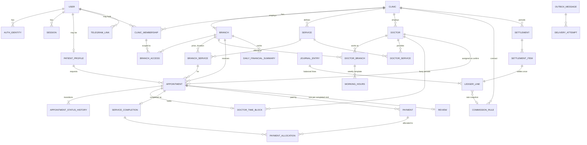

# Database Design

Status: **Phase 1 proposal**. There are no migrations yet.

PostgreSQL 18 with the `btree_gist` and `citext` extensions. All timestamps are `timestamptz` (UTC).
Money is `numeric(19,2)` with a `currency char(3)` (v1: UZS). Keys are UUID v7. Schemas: `identity`,
`tenancy`, `staff`, `catalog`, `scheduling`, `booking`, `finance`, `notify`, `audit`.

## 1. ER diagram



## 2. Tables and constraints (key columns)

**identity**
- `users` (id, display_name, status, security_stamp)
- `auth_identities` (user_id, kind Phone/Telegram/EmailPassword, normalized_identifier, verified_at). **UNIQUE(kind, normalized_identifier)**
- `password_credentials` (user_id, hash)
- `otp_challenges` (purpose, identifier_hash, **code_hash**, expires_at, attempts, consumed_at)
- `sessions` (user_id, expires_at, revoked_at, ip_hash, user_agent)
- `account_link_requests` (user_id, target_kind, target_identifier_hash, proof_token_hash, expires_at)
- `patient_profiles` (user_id PK, full_name, contact_phone). **No medical fields.**

**tenancy / staff**
- `clinics` (verification_status Pending/Approved/Suspended/Rejected)
- `branches` (clinic_id, address, lat/lon numeric, time_zone IANA default `Asia/Tashkent`, is_active). **UNIQUE(clinic_id, id)** is the target for composite FKs
- `branch_booking_locks` (branch_id PK), the row locked during booking/confirm
- `clinic_memberships` (clinic_id, user_id, role, scope Clinic/Branches, status). UNIQUE(clinic_id, user_id)
- `branch_access` (clinic_id, membership_id, branch_id), composite FKs to both sides
- `platform_admin_grants` (user_id, permission, granted_by, revoked_at)

**catalog / scheduling**
- `services` (clinic_id, name, is_active). UNIQUE(clinic_id, id)
- `branch_services` (clinic_id, branch_id, service_id, price ≥ 0, price_kind Fixed/From, duration_minutes 5–480). FK (clinic_id, branch_id), FK (clinic_id, service_id)
- `doctors` (clinic_id, user_id null, display_name, is_active). UNIQUE(clinic_id, id)
- `doctor_branches` (clinic_id, doctor_id, branch_id) and `doctor_services` (clinic_id, doctor_id, service_id), composite FKs
- `working_hours` (clinic_id, doctor_id, branch_id, weekday, start_local, end_local, effective_from/to). FK → doctor_branches. CHECK start < end
- `doctor_time_blocks` (clinic_id, branch_id, doctor_id, period tstzrange `[)`, kind Hold/Appointment/TimeOff, appointment_id UNIQUE null, is_active)
  ```sql
  CREATE EXTENSION IF NOT EXISTS btree_gist;
  ALTER TABLE scheduling.doctor_time_blocks
    ADD CONSTRAINT ex_doctor_time_blocks_no_overlap
    EXCLUDE USING gist (doctor_id WITH =, period WITH &&) WHERE (is_active),
    ADD CONSTRAINT ck_period_valid CHECK (NOT isempty(period) AND lower_inc(period) AND NOT upper_inc(period));
  ```
  The predicate can't use `now()`, which is why the booking transaction expires overdue holds first (ADR-006).

Working hours are branch-local wall-clock times, converted per date with the IANA zone (DST-safe).

**booking**
- `appointments` (clinic_id, branch_id, service_id, patient_user_id, doctor_id null, starts_at, ends_at, status, expires_at, quoted_price, price_kind, currency, contact_name, contact_phone, xmin concurrency token)
  - FK (clinic_id, branch_id)→branches. FK (clinic_id, branch_id, service_id)→branch_services. FK (clinic_id, branch_id, doctor_id)→doctor_branches. FK (clinic_id, doctor_id, service_id)→doctor_services
  - CHECK ends_at > starts_at. CHECK status in the 8 values. CHECK doctor_id NOT NULL when status ∈ {Confirmed, Completed, NoShow}. CHECK Pending ⇒ expires_at NOT NULL
  - Indexes: (branch_id, starts_at), (patient_user_id, created_at DESC), partial (expires_at) WHERE status='Pending'
- `appointment_status_history` (from, to, actor_kind, actor_user_id, reason_code, occurred_at)
- `idempotency_keys` PK(user_id, key), request_hash, response snapshot

**finance** (details in FINANCIAL_RULES.md)
- `service_completions` (appointment_id **UNIQUE**, charged_amount)
- `payments` (direction In/Refund, method, amount > 0, status Recorded/Failed/Voided, collected_by Clinic/Platform, refund_of_payment_id, **UNIQUE(clinic_id, idempotency_key)**)
- `payment_allocations` (payment_id, service_completion_id, amount)
- `commission_rules` (basis enum with **no default**, rate numeric(7,4) or fixed, rounding_mode, effective range, contract_reference, approved_by). Exclusion constraint: no overlapping ranges per (clinic, basis)
- `journal_entries` (entry_type, **source_event_key UNIQUE**, posting_date_local, reverses_entry_id)
- `ledger_lines` (account, party, signed amount, currency, commission_rule_id, rate_snapshot, basis_amount_snapshot)
- `settlements` (clinic, period, status). UNIQUE(clinic_id, period_start) WHERE status <> 'Voided'
- `settlement_items` (ledger_line_id **UNIQUE**)
- `daily_financial_summaries` PK(branch_id, local_date), totals, ledger_watermark. Rebuildable

Append-only: no UPDATE/DELETE grants on `journal_entries`, `ledger_lines`, `audit_log` or
`appointment_status_history`, plus a trigger guard. A deferred constraint trigger requires every
journal entry to balance to 0.

**notify / reviews / audit**
- `outbox_messages` (type, dedup_key UNIQUE, payload jsonb of ids + minimal display data, not_before, status, attempts, next_attempt_at, last_error scrubbed)
- `delivery_attempts`, `telegram_links` (user_id, chat_id), `telegram_link_tokens` (token_hash, expires_at, used_at)
- `reviews` (appointment_id UNIQUE, rating 1–5, text, moderation_status)
- `audit_log` (actor, action, clinic_id, branch_id, target, correlation_id, scrubbed details)

## 3. DB roles (least privilege) — implemented in `deploy/postgres/init/01-create-roles.sh`

| Role | Login | Rights |
|---|---|---|
| `oqtish_owner` | yes | owns database and schemas; used only by the `migrate` container |
| `oqtish_app` | no (group) | default privileges: USAGE on schemas, SELECT/INSERT/UPDATE/DELETE on tables, USAGE/SELECT on sequences created by `oqtish_owner` |
| `oqtish_api` | yes | member of `oqtish_app` |
| `oqtish_worker` | yes | member of `oqtish_app` |
| `oqtish_report_ro`, `oqtish_backup` | — | planned (Phase 5 / Phase 8) |

`PUBLIC` has no database or `public`-schema CREATE rights. Append-only tables will revoke UPDATE/DELETE
from `oqtish_app` in their own migrations. The init script runs only when the data volume is empty;
changing roles on an existing database requires a migration or a reviewed SQL script.

## 4. RLS (defense in depth, Phase 8, OD-13)

Planned on appointments, patient_profiles, payments, ledger_lines and audit_log. Policies read
`current_setting('app.clinic_ids', true)`, which a connection interceptor sets with `SET LOCAL` per
transaction (safe under pooling). The Worker role has an explicit cross-tenant policy. Tests pass with
RLS both off and on.

## 5. Migration policy

- EF Core migrations. Review the idempotent script in each MR. Raw SQL for constraints, triggers,
  grants and RLS, each with a tested `Down`.
- CI: apply to an empty DB, then Down one step and Up again.
- Destructive changes need expand/contract plus explicit approval, with backup and rollback documented first.
- The seed command creates only fictional data and refuses to run in Production.
