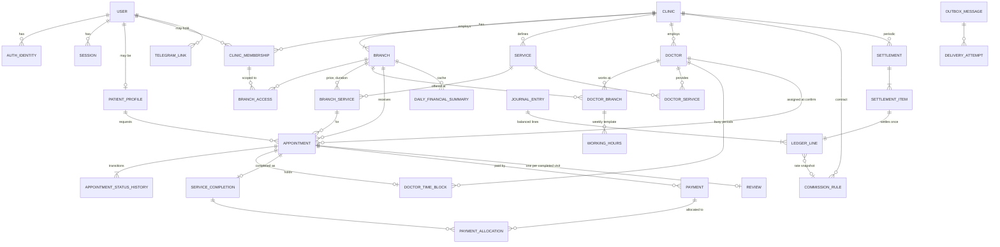

# Database Design

Status: Phase 1 proposal, partly implemented. Migrations: `InitialExtensions`, `CoreIdentityTenancy` (§2.1), `CatalogScheduling` (§2.2).

PostgreSQL 18 with the `btree_gist` and `citext` extensions. All timestamps are `timestamptz` (UTC).
Money is `numeric(19,2)` with a `currency char(3)` (v1: UZS). Keys are UUID v7. Schemas: `identity`,
`tenancy`, `staff`, `catalog`, `scheduling`, `booking`, `finance`, `notify`, `audit`.

## 1. ER diagram



## 2. Tables and constraints (key columns)

**identity**
- `users` (id, display_name, status, security_stamp)
- `auth_identities` (user_id, kind Phone/Telegram/EmailPassword, normalized_identifier, verified_at). **UNIQUE(kind, normalized_identifier)**
- `password_credentials` (user_id, hash)
- `otp_challenges` (purpose, identifier_hash, **code_hash**, expires_at, attempts, consumed_at)
- `sessions` (user_id, expires_at, revoked_at, ip_hash, user_agent)
- `account_link_requests` (user_id, target_kind, target_identifier_hash, proof_token_hash, expires_at)
- `patient_profiles` (user_id PK, full_name, contact_phone). **No medical fields.**

**tenancy / staff**
- `clinics` (verification_status Pending/Approved/Suspended/Rejected)
- `branches` (clinic_id, address, lat/lon numeric, time_zone IANA default `Asia/Tashkent`, is_active). **UNIQUE(clinic_id, id)** is the target for composite FKs
- `branch_booking_locks` (branch_id PK), the row locked during booking/confirm
- `clinic_memberships` (clinic_id, user_id, role, scope Clinic/Branches, status). UNIQUE(clinic_id, user_id)
- `branch_access` (clinic_id, membership_id, branch_id), composite FKs to both sides
- `platform_admin_grants` (user_id, permission, granted_by, revoked_at)

**catalog / scheduling**
- `services` (clinic_id, name, is_active). UNIQUE(clinic_id, id)
- `branch_services` (clinic_id, branch_id, service_id, price ≥ 0, price_kind Fixed/From, duration_minutes 5–480). FK (clinic_id, branch_id), FK (clinic_id, service_id)
- `doctors` (clinic_id, user_id null, display_name, is_active). UNIQUE(clinic_id, id)
- `doctor_branches` (clinic_id, doctor_id, branch_id) and `doctor_services` (clinic_id, doctor_id, service_id), composite FKs
- `working_hours` (clinic_id, doctor_id, branch_id, weekday, start_local, end_local, effective_from/to). FK → doctor_branches. CHECK start < end
- `doctor_time_blocks` (clinic_id, branch_id, doctor_id, period tstzrange `[)`, kind Hold/Appointment/TimeOff, appointment_id UNIQUE null, is_active)
  ```sql
  CREATE EXTENSION IF NOT EXISTS btree_gist;
  ALTER TABLE scheduling.doctor_time_blocks
    ADD CONSTRAINT ex_doctor_time_blocks_no_overlap
    EXCLUDE USING gist (doctor_id WITH =, period WITH &&) WHERE (is_active),
    ADD CONSTRAINT ck_period_valid CHECK (NOT isempty(period) AND lower_inc(period) AND NOT upper_inc(period));
  ```
  The predicate can't use `now()`, which is why the booking transaction expires overdue holds first (ADR-006).

Working hours are branch-local wall-clock times, converted per date with the IANA zone (DST-safe).

**booking**
- `appointments` (clinic_id, branch_id, service_id, patient_user_id, doctor_id null, starts_at, ends_at, status, expires_at, quoted_price, price_kind, currency, contact_name, contact_phone, xmin concurrency token)
  - FK (clinic_id, branch_id)→branches. FK (clinic_id, branch_id, service_id)→branch_services. FK (clinic_id, branch_id, doctor_id)→doctor_branches. FK (clinic_id, doctor_id, service_id)→doctor_services
  - CHECK ends_at > starts_at. CHECK status in the 8 values. CHECK doctor_id NOT NULL when status ∈ {Confirmed, Completed, NoShow}. CHECK Pending ⇒ expires_at NOT NULL
  - Indexes: (branch_id, starts_at), (patient_user_id, created_at DESC), partial (expires_at) WHERE status='Pending'
- `appointment_status_history` (from, to, actor_kind, actor_user_id, reason_code, occurred_at)
- `idempotency_keys` PK(user_id, key), request_hash, response snapshot

**finance** (details in FINANCIAL_RULES.md)
- `service_completions` (appointment_id **UNIQUE**, charged_amount)
- `payments` (direction In/Refund, method, amount > 0, status Recorded/Failed/Voided, collected_by Clinic/Platform, refund_of_payment_id, **UNIQUE(clinic_id, idempotency_key)**)
- `payment_allocations` (payment_id, service_completion_id, amount)
- `commission_rules` (basis enum with **no default**, rate numeric(7,4) or fixed, rounding_mode, effective range, contract_reference, approved_by). Exclusion constraint: no overlapping ranges per (clinic, basis)
- `journal_entries` (entry_type, **source_event_key UNIQUE**, posting_date_local, reverses_entry_id)
- `ledger_lines` (account, party, signed amount, currency, commission_rule_id, rate_snapshot, basis_amount_snapshot)
- `settlements` (clinic, period, status). UNIQUE(clinic_id, period_start) WHERE status <> 'Voided'
- `settlement_items` (ledger_line_id **UNIQUE**)
- `daily_financial_summaries` PK(branch_id, local_date), totals, ledger_watermark. Rebuildable

Append-only: no UPDATE/DELETE grants on `journal_entries`, `ledger_lines`, `audit_log` or
`appointment_status_history`, plus a trigger guard. A deferred constraint trigger requires every
journal entry to balance to 0.

**notify / reviews / audit**
- `outbox_messages` (type, dedup_key UNIQUE, payload jsonb of ids + minimal display data, not_before, status, attempts, next_attempt_at, last_error scrubbed)
- `delivery_attempts`, `telegram_links` (user_id, chat_id), `telegram_link_tokens` (token_hash, expires_at, used_at)
- `reviews` (appointment_id UNIQUE, rating 1–5, text, moderation_status)
- `audit_log` (actor, action, clinic_id, branch_id, target, correlation_id, scrubbed details)

## 2.1 Implemented — migration `CoreIdentityTenancy` (BE1a, 2026-10-18)

All ids `uuid` (v7, app-generated), enums stored as `text` with a `CHECK (col IN (…))` constraint, times `timestamptz`.

| Table | Key columns / constraints |
|---|---|
| `identity.users` | id, display_name, status (Active/Suspended/Deleted), security_stamp, status_reason, created_at, updated_at, deleted_at. ix(status) |
| `identity.auth_identities` | user_id → users (cascade), kind (Phone/Telegram/EmailPassword), normalized_identifier (E.164 / Telegram id / lower-case e-mail), verified_at, last_used_at. **UNIQUE(kind, normalized_identifier)**, UNIQUE(user_id, kind) |
| `identity.password_credentials` | user_id PK → users, password_hash (Identity V3 format), failed_attempts ≥ 0, locked_until |
| `identity.otp_challenges` | purpose (SignIn/LinkPhone/PasswordReset), identifier_hash (HMAC), phone (null for decoys), user_id null → users, code_hash (HMAC), ip_hash, expires_at > created_at, attempts ≤ max_attempts, consumed_at. ix(identifier_hash, created_at), ix(ip_hash, created_at), ix(created_at) for retention |
| `identity.sessions` | user_id → users, **token_hash UNIQUE** (SHA-256 of the cookie token), security_stamp, auth_method, created_at, last_seen_at, expires_at, revoked_at, revoked_reason, ip_hash, user_agent(256). ix(user_id, revoked_at) |
| `identity.totp_credentials` | user_id PK, protected_secret (Data Protection), enabled_at (null = pending setup), last_used_step (replay guard) |
| `identity.patient_profiles` | user_id PK, full_name(100), contact_phone, is_anonymised. No medical fields |
| `identity.data_protection_keys` | ASP.NET Data Protection key ring (id, friendly_name, xml) |
| `tenancy.clinics` | name, legal_name, description, phone, verification_status (Pending/Approved/Suspended/Rejected), status_reason, created_by_user_id → users (set null) |
| `tenancy.branches` | clinic_id → clinics, name, district, address, latitude/longitude numeric(9,6) (range checks, both or neither), phone, time_zone default `Asia/Tashkent`, is_active. **UNIQUE(clinic_id, id)** (`ak_branches_clinic_id_id`) |
| `tenancy.branch_opening_hours` | (clinic_id, branch_id) → branches cascade, weekday 1–7, opens < closes, UNIQUE(branch_id, weekday, opens) |
| `tenancy.branch_booking_locks` | branch_id PK, (clinic_id, branch_id) → branches cascade. **Row created by trigger `trg_branches_booking_lock` on branch insert** — never insert manually |
| `staff.clinic_memberships` | clinic_id → clinics, user_id → users, role, scope (Clinic/Branches), status (Active/Suspended/Removed). **UNIQUE(clinic_id, user_id)**, UNIQUE(clinic_id, id) |
| `staff.branch_access` | PK(membership_id, branch_id); (clinic_id, membership_id) → memberships and (clinic_id, branch_id) → branches, both composite + cascade (cross-clinic grants are impossible, tested) |
| `staff.staff_invitations` | clinic_id → clinics (cascade), phone_hash (HMAC of E.164), phone_masked, role, scope, branch_ids uuid[] (non-empty when scope = Branches), invited_by_user_id, expires_at > created_at, accepted_at, accepted_by_user_id, revoked_at. Partial ix(phone_hash) WHERE open |
| `staff.platform_admin_grants` | user_id, permission, granted_by/revoked_by user ids, granted_at, revoked_at. UNIQUE(user_id, permission) WHERE revoked_at IS NULL |
| `notify.outbox_messages` | type, **dedup_key UNIQUE**, payload jsonb, created_at, not_before, status (Pending/Processing/Sent/Failed/Cancelled), attempts ≥ 0, next_attempt_at, last_error(500), sent_at. Partial ix(next_attempt_at) WHERE status = 'Pending' |
| `notify.telegram_link_tokens` | user_id → users, token_hash UNIQUE (SHA-256), expires_at, used_at |
| `notify.telegram_links` | user_id PK → users, telegram_user_id UNIQUE, chat_id, linked_at |
| `audit.audit_log` | occurred_at (default now()), actor_kind (User/System/Anonymous), actor_user_id, action, clinic_id, branch_id, target_type, target_id, correlation_id, ip_hash, details jsonb. No FKs. **Append-only:** trigger `trg_audit_log_append_only` (UPDATE/DELETE) and `trg_audit_log_no_truncate` raise 42501 for every role; `REVOKE UPDATE, DELETE, TRUNCATE … FROM oqtish_app` when that role exists |
| `common.idempotency_keys` | PK(user_id, key ≤ 64), request_hash (SHA-256 of the request JSON), status (InProgress/Completed), response_json jsonb, created_at, completed_at |

Not created (by decision): `identity.account_link_requests` (conflicts are audited instead, DECISIONS.md BE1a-5).

## 2.2 Implemented — migration `CatalogScheduling` (BE1b, 2026-10-18)

| Table / object | Key columns / constraints |
|---|---|
| `tenancy.clinics` (+2 columns) | `rating_average numeric(3,2)` null (CHECK 1..5), `review_count int` default 0 (CHECK ≥ 0). Maintained by review moderation (BE2) via `Clinic.SetRating`; read by public search |
| `catalog.services` | id, clinic_id → clinics, name(200), category(32, key of the fixed catalogue, validated in the handler), is_active, created_at, updated_at. **UNIQUE(clinic_id, id)**. ix(clinic_id, is_active), ix(category) |
| `catalog.branch_services` | PK(branch_id, service_id); **UNIQUE(clinic_id, branch_id, service_id)** (target of the appointment FK in BE2); FK (clinic_id, branch_id) → branches and (clinic_id, service_id) → services, both composite + cascade. price numeric(19,2) **CHECK ≥ 0**, currency char(3) CHECK 'UZS', price_kind CHECK Fixed/From, duration_minutes **CHECK 5..480**, is_active |
| `scheduling.doctors` | id, clinic_id → clinics, user_id null → identity.users (restrict), display_name(200), is_active. **UNIQUE(clinic_id, id)**; **UNIQUE(clinic_id, user_id) WHERE user_id IS NOT NULL** (a user is a doctor at most once per clinic); ix(user_id) |
| `scheduling.doctor_branches` | PK(doctor_id, branch_id); **UNIQUE(clinic_id, doctor_id, branch_id)**; composite FKs (clinic_id, doctor_id) → doctors and (clinic_id, branch_id) → branches (cascade) |
| `scheduling.doctor_services` | PK(doctor_id, service_id); **UNIQUE(clinic_id, doctor_id, service_id)**; composite FKs to doctors and services (cascade) |
| `scheduling.working_hours` | id, clinic_id, doctor_id, branch_id, weekday smallint **CHECK 1..7**, start_local / end_local `time` **CHECK start < end**. FK (clinic_id, doctor_id, branch_id) → doctor_branches (cascade: unlinking a branch removes its hours). **Exclusion constraint `ex_working_hours_no_overlap`**: `EXCLUDE USING gist (doctor_id WITH =, weekday WITH =, scheduling.timerange(start_local, end_local, '[)') WITH &&)` — no overlapping intervals for one doctor on a weekday across all branches (adjacent intervals allowed) |
| type `scheduling.timerange` | `CREATE TYPE … AS RANGE (subtype = time)` (used by the exclusion constraint) |
| function `tenancy.distance_km(lat1, lng1, lat2, lng2 numeric) → numeric` | IMMUTABLE STRICT SQL: Haversine great-circle distance in km (R = 6371), rounded to 2 decimals (OD-16). Mapped to `GeoFunctions.DistanceKm` for LINQ |

Not created (by design): `effective_from/to` on working hours (v1 has one weekly template per doctor),
reviews/abuse reports (BE2), booking/finance tables. `Down` drops the function, constraint and type
before the tables; the latest-migration Down → Up test covers it.

## 3. Database roles — implemented in `deploy/postgres/init/01-create-roles.sh`

| Role | Login | Rights |
|---|---|---|
| `oqtish_owner` | yes | owns database and schemas; used only by the `migrate` container |
| `oqtish_app` | no (group) | default privileges: USAGE on schemas, SELECT/INSERT/UPDATE/DELETE on tables, USAGE/SELECT on sequences created by `oqtish_owner` |
| `oqtish_api` | yes | member of `oqtish_app` |
| `oqtish_worker` | yes | member of `oqtish_app` |
| `oqtish_report_ro`, `oqtish_backup` | — | planned (Phase 5 / Phase 8) |

`PUBLIC` has no database or `public`-schema CREATE rights. Append-only tables will revoke UPDATE/DELETE
from `oqtish_app` in their own migrations. The init script runs only when the data volume is empty;
changing roles on an existing database requires a migration or a reviewed SQL script.

## 4. RLS (defense in depth, Phase 8, OD-13)

Planned on appointments, patient_profiles, payments, ledger_lines and audit_log. Policies read
`current_setting('app.clinic_ids', true)`, which a connection interceptor sets with `SET LOCAL` per
transaction (safe under pooling). The Worker role has an explicit cross-tenant policy. Tests pass with
RLS both off and on.

## 5. Migration policy

- EF Core migrations. Review the idempotent script in each MR. Raw SQL for constraints, triggers,
  grants and RLS, each with a tested `Down`.
- CI: apply to an empty DB, then Down one step and Up again.
- Destructive changes need expand/contract plus explicit approval, with backup and rollback documented first.
- The seed command creates only fictional data and refuses to run in Production.
